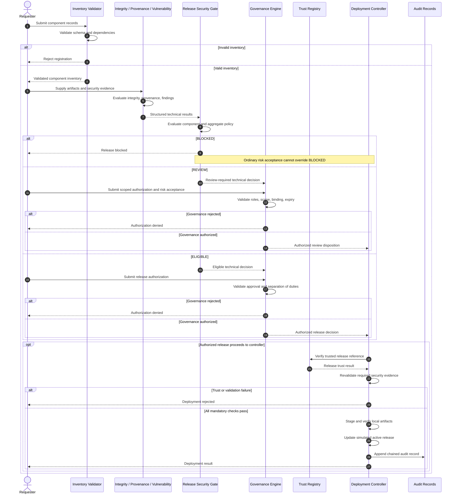

# Project 8 — Secure Release Authorization

**Environment:** Local, offline, synthetic security laboratory  
**Scope:** Technical release evaluation and governance authorization  
**Validation:** 242 automated tests passing

## Authorization Sequence

## Release Security Invariants

1. **Mandatory blocking:** A `BLOCKED` technical decision cannot be overridden through ordinary risk acceptance.
2. **Explicit review:** A `REVIEW` decision requires valid risk disposition and applicable authorization.
3. **Independent governance:** An `ELIGIBLE` decision does not independently authorize deployment.
4. **Trusted identity:** The release must satisfy trusted registration requirements.
5. **Artifact verification:** Applicable artifact references and bytes must be verified.
6. **Rejection safety:** Rejected operations must not activate the requested release.

## Implementation and Evidence

**Implementation:**

- `src/policy/release_gate.py`
- `src/policy/governance.py`
- `src/trust/registry.py`
- `src/deployment/controller.py`

**Relevant tests:**

- `tests/test_release_gate.py`
- `tests/test_governance.py`
- `tests/test_governance_consistency.py`
- `tests/test_risk_acceptance_integration.py`
- `tests/test_trust_registry.py`
- `tests/test_deployment_controller.py`
- `tests/test_deployment_trust_enforcement.py`

The diagram describes logical authorization requirements, not network communications between independently deployed services.

**Limitations:** Synthetic identities, local trust authority, simulated release transitions, and no production approval infrastructure.