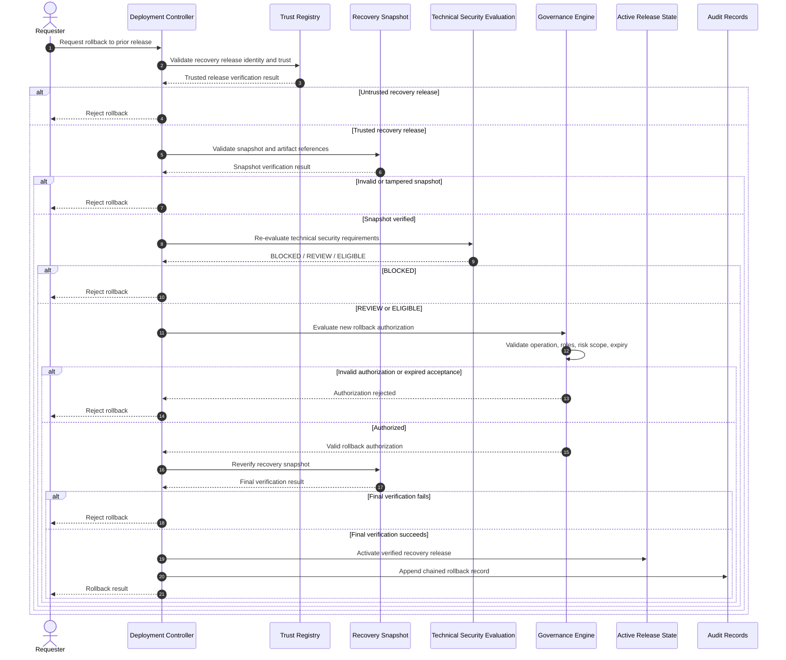

# Project 8 — Verified Rollback and Recovery

**Environment:** Local, offline, synthetic security laboratory  
**Scope:** Trusted recovery release verification and rollback authorization  
**Validation:** 242 automated tests passing

## Recovery Sequence

## Recovery Security Invariants

1. **Fresh authorization:** Previous deployment approval does not automatically authorize rollback.
2. **Trusted recovery target:** The target must match an accepted trusted release reference.
3. **Snapshot integrity:** Recovery artifacts must pass applicable integrity and path checks.
4. **Fresh technical evaluation:** Rollback requires current security evaluation.
5. **Expiration enforcement:** Expired risk acceptance cannot be reused.
6. **Rejection safety:** Failed rollback authorization must not activate the requested recovery release.

## Implementation and Evidence

**Implementation:** `src/deployment/controller.py`

**Relevant tests:**

- `tests/test_deployment_controller.py`
- `tests/test_deployment_hardening.py`
- `tests/test_deployment_trust_enforcement.py`
- `tests/test_risk_acceptance_integration.py`

## Operational Limitations

The laboratory does not implement:

- Automatic health-triggered rollback.
- Production cloud orchestration.
- Crash-atomic release transactions.
- Concurrency-safe state transitions.
- Durable external audit storage.
- Production signing-key custody.

Rollback is a simulated, explicitly requested operation subject to independent security authorization.