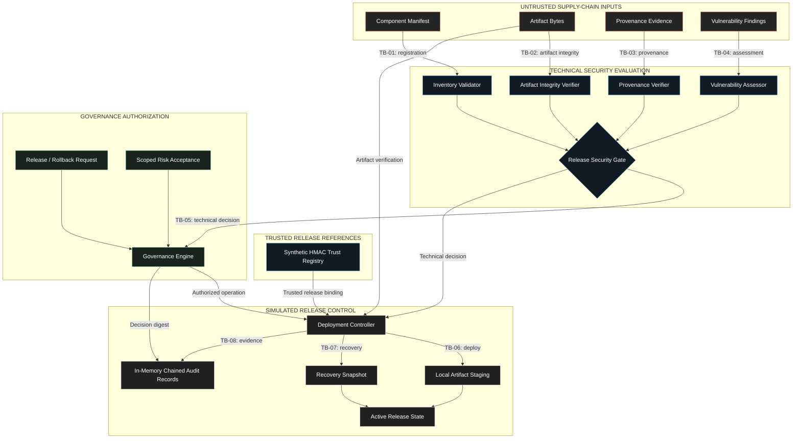

# Project 8 — System Security Architecture

**Environment:** Local, offline, synthetic security laboratory  
**Scope:** AI supply-chain evaluation, governance, and simulated deployment  
**Validation:** 242 automated tests passing

## Architecture Diagram

## Trust Boundaries

| Boundary | Description |
|---|---|
| TB-01 | External component records enter inventory validation |
| TB-02 | Artifact bytes and digest claims enter integrity verification |
| TB-03 | Provenance assertions enter provenance evaluation |
| TB-04 | Vulnerability findings enter technical policy evaluation |
| TB-05 | Technical security decisions enter governance authorization |
| TB-06 | Authorized release requests enter deployment control |
| TB-07 | Recovery requests enter rollback processing |
| TB-08 | Operational outcomes contribute to audit evidence |

## Security Interpretation

The architecture separates technical evaluation, governance authorization, and deployment authority.

A caller-supplied artifact digest or manifest does not independently establish release trust. The synthetic trust registry provides authenticated release references that are verified during deployment operations.

The diagram groups related security responsibilities logically; it does not imply that every component is an independently deployed service.

**Implementation:** `src/inventory/`, `src/integrity/`, `src/provenance/`, `src/scanning/`, `src/policy/`, `src/trust/`, and `src/deployment/`.

**Limitations:** No production cloud infrastructure, enterprise identity authentication, external signing authority, or durable audit storage.